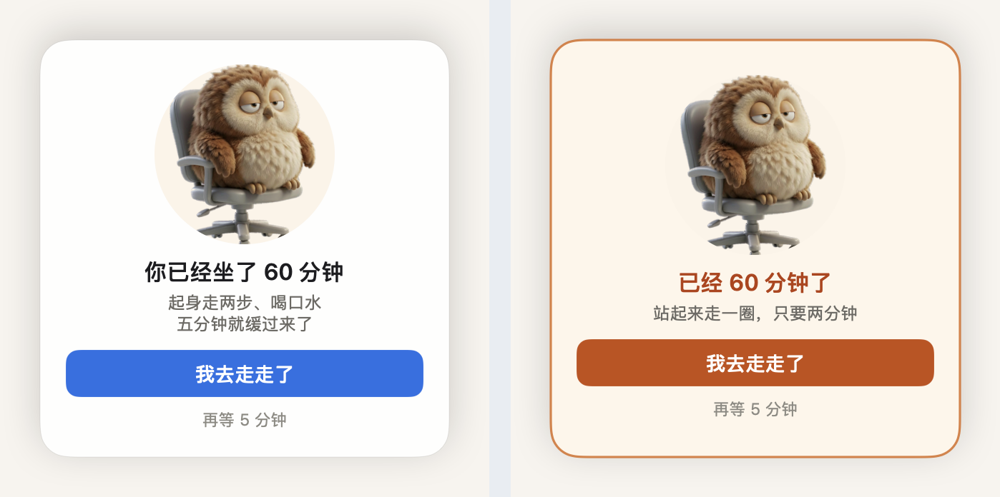
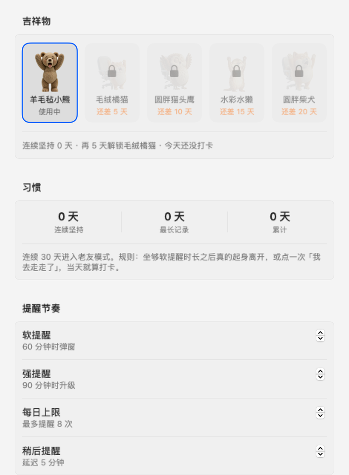
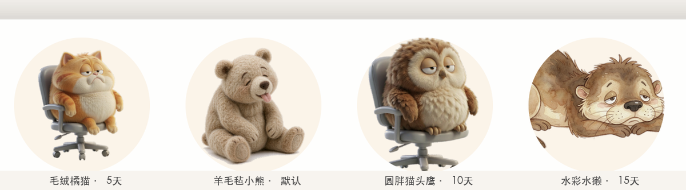
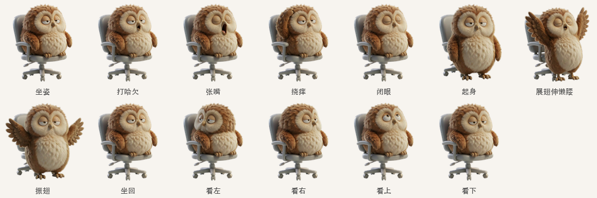

# 歇会儿 · 一个住在屏幕下角的小动物

> 你坐久了，它会自己冒出来提醒你起来走走。你不管它，它就一直赖在那儿不走。

一个 macOS 菜单栏久坐提醒工具。和普通定时器不同的是：**提醒你的是只会动的动物**——它打哈欠、从椅子上下来伸懒腰、捶两拳，然后摊回椅子上看着你。它可以被戳、会躲、会盯着你的鼠标看。



## 目录

- [它和别的久坐提醒有什么不一样](#它和别的久坐提醒有什么不一样)
- [安装](#安装)
- [使用](#使用)
- [设置项](#设置项)
- [形象与解锁](#形象与解锁)
- [隐私与权限](#隐私与权限)
- [常见问题](#常见问题)
- [已知限制](#已知限制)
- [开发与迭代](#开发与迭代)

## 它和别的久坐提醒有什么不一样

**1. 判断依据是「你真的在不在」，不是「时间到了没有」**

用系统空闲时长（距上次键鼠操作多久）倒推专注时长。你人离开了，计时自动归零——不需要你点「我去休息了」，也不会在你刚回来的时候冲你喊。

「没碰键鼠」和「人走了」不是一回事，所以判定拆成两档：

| 空闲时长 | 判定 | 计时 |
|---|---|---|
| < 暂停判定（默认 1 分钟） | 人在电脑前 | 正常累加 |
| 暂停判定 ~ 真正离开（1~5 分钟） | 手停了，人还在座位上——看长文档、看视频、开会听人讲 | **暂停累加，不清零** |
| ≥ 真正离开（默认 5 分钟） | 起身走开了 | 归零 |

早先只有一档（1 分钟不动就清零），结果读一篇长文档、看一段视频的功夫，坐了两小时也会被抹掉——工具漏记的恰好是它最该管的那种久坐。两档之后，`暂离` 只冻结数字，不销毁进度。

判定口径故意从紧：**坐够软提醒阈值之后才离开**才算一次真正的休息。随手离开一分钟就想打卡？不算。

**2. 提醒强度是分级的，动物性格也跟着分级**

| 阶段 | 触发 | 弹窗行为 | 动物行为 |
|---|---|---|---|
| 软提醒 | 专注达 `focusMinutes` | 出现在屏幕右下角，白卡片，蓝色按钮 | 克制。被戳抖一下就好 |
| 升级 | 弹出后 `escalateSeconds` 秒无响应 | 卡片转暖色，标题变橙，按钮变橙 | 开始沿屏幕下缘左右游走 |
| 强提醒 | 专注达 `strongMinutes` 仍未响应 | 窗口层级提到 `.screenSaver`，播放提示音 | **贴着你的鼠标跑**，挡在你正在点的位置旁边——但不会盖住你点的地方 |

「越来越烦」本身就是提醒强度的表达。不做全屏遮盖（那样会打断你），也不做静音轮播。

**3. 会开会就闭嘴**

摄像头或麦克风被占用时判定为在开会，不弹窗；会议一结束，立刻把欠下的那次提醒补上。不会因为你开了两小时会就一直沉默到下班。

**4. 有一点点养成的意思**

连续坚持会解锁新的动物形象，第 30 天进入「老友模式」——文案从催促换成熟人语气（「又到 60 分钟啦」），而不是继续加感叹号。

## 安装

### 方式一：直接下载（只想用，不想编译）

1. 到仓库的 **Releases** 页面下载最新的 `歇会儿.app`，或下载源码后自行编译（见方式二）
2. 拖进「应用程序」文件夹
3. **首次打开需要右键 → 打开**（这个 app 没有做 Apple 签名和公证，直接双击会被 Gatekeeper 拦下）
4. 首次运行会自动弹出设置窗口，菜单栏出现 `🚶 0m`

> 如果你连右键打开也失败，可以在「系统设置 → 隐私与安全性」页面底部点「仍要打开」。

### 方式二：自己编译（约 10 秒）

只需要 **Xcode Command Line Tools**，不需要完整 Xcode。

```bash
# 1. 装命令行工具（已装过可跳过）
xcode-select --install

# 2. 编译打包
git clone <本仓库地址> && cd <仓库目录>
./build.sh

# 3. 跑起来
open 歇会儿.app
```

`build.sh` 做三件事：`swiftc` 编译 11 个 Swift 文件 → 组装 `.app` bundle 并拷入素材 → 本地临时签名（`codesign -s -`）。

环境验证过的版本：**macOS 14 / Swift 6.0.3 / arm64**。理论上 macOS 13+ 都能跑（Info.plist 里 `LSMinimumSystemVersion` 是 13.0）。

## 使用

### 菜单栏

```
🚶 12m                       ← 当前连续专注时长；暂停时显示「暂停」，免打扰时段显示「免打扰」
├─ 已连续专注 12 分钟（软 60 / 强 90）
├─ 今日已提醒 1 / 8 次
├─ 连续坚持 3 天 · 再 2 天解锁毛绒橘猫
├──────────────────────
├─ 立即提醒我一次        ⌘T     ← 手动预览，不占今天的提醒名额
├─ 预览强提醒            ⌘S
├─ 重置计时              ⌘R
├──────────────────────
├─ 暂停 1 小时           ⌘P
├─ 设置…                 ⌘,
├─ 解锁全部形象（调试）
├─ 模拟打卡 +1 天（调试）
├──────────────────────
└─ 退出歇会儿            ⌘Q
```

### 卡片上的两个按钮

- **我去走走了** — 清零计时并打卡（只有坐够软提醒阈值才算，防止用这个按钮刷天数）
- **再等 N 分钟** — 顺延 `snoozeMinutes` 分钟

### 和它互动

| 动作 | 结果 |
|---|---|
| 戳它一下 | 挠挠头 + 眼睛眨一下，冒一句吐槽（「戳我干嘛」「去倒杯水吧」） |
| 3.5 秒内连戳三次 | 往反方向躲开 78 像素，摆出防御姿态，说「躲开你」 |
| 鼠标在屏幕上移动 | 它会转头跟着看（只在坐姿时生效，站起来做动作时不看） |
| 按住卡片拖动 | 可以拖到任意位置。松手 1 秒后自动行为恢复 |

## 设置项



| 分组 | 项目 | 默认值 | 说明 |
|---|---|---|---|
| 提醒节奏 | 软提醒 | 60 分钟 | 到这个时长弹出提醒 |
| | 强提醒 | 90 分钟 | 到这个时长仍未响应则升级 |
| | 每日上限 | 8 次 | 一天最多提醒几次，超过后状态栏显示「已满」 |
| | 稍后提醒 | 5 分钟 | 「再等 N 分钟」的 N |
| 免打扰 | 启用 / 起止时间 | 关闭 / 12:00–13:30 | 支持跨午夜（比如 23:00–08:00） |
| 行为 | 不理会时自动游走 | 开 | 关掉后卡片就固定不动 |
| | 升级为起身动作 | 12 秒 | 弹出多久无响应开始游走 |
| | 暂停计时 | 1 分钟 | 多久没碰键鼠就暂停累加（不清零） |
| | 真正离开 | 5 分钟 | 走开超过这个时长才算休息，计时归零 |
| | 开会时暂缓提醒 | 开 | 摄像头/麦克风占用时不弹，会后补 |
| 启动 | 开机自动启动 | 关 | 写 LaunchAgent，不依赖开发者证书 |

所有设置存在 `UserDefaults`，键名见 `Sources/Prefs.swift`。

## 形象与解锁



| 形象 | 代号 | 解锁条件 |
|---|---|---|
| 羊毛毡小熊 | `c` | 默认拥有 |
| 毛绒橘猫 | `a` | 连续坚持 5 天 |
| 圆胖猫头鹰 | `d` | 连续坚持 10 天 |
| 水彩水獭 | `b` | 连续坚持 15 天 |
| 老友模式（不是形象，是语气） | — | 连续坚持 30 天 |

解锁的瞬间会自动换上，并在菜单栏播报一句。**不想等就直接用菜单里的「解锁全部形象（调试）」**。

形象解锁门槛在 `Sources/Habits.swift` 的 `Unlocks.styles` 里，改数组就行。

### 每个形象的动作语汇不一样

四个形象共用同一套三幕叙事（**困 → 起身卖力 → 瘫回去**），但「卖力」那一拍按解剖学各表：

- 橘猫 / 小熊 / 水獭：站起来伸懒腰 → 捶两拳
- 猫头鹰：站起来展翅伸懒腰 → 振翅两下

猫头鹰是栖鸟，翅膀长在体侧、没有能握的手。硬让它握拳打人既不合解剖，AI 也画不出来（试过两版，出来都是「伸翅膀打招呼」，而且每版都把体型画小一圈）。



动作库的选择在 `MascotRoutine.variants(for:)`。完整动作循环（含呼吸与停顿时序）见 [`docs/images/owl-loop.mp4`](docs/images/owl-loop.mp4)。

## 隐私与权限

**不需要任何系统权限。** 没有「辅助功能」授权弹窗，没有屏幕录制，没有网络请求。

| 用到的能力 | 实现方式 | 是否需要授权 |
|---|---|---|
| 判断你在不在 | `CGEventSource.secondsSinceLastEventType`（系统公开 API 返回空闲秒数） | 不需要 |
| 判断是否在开会 | `AVCaptureDevice.isInUseByAnotherApplication` + CoreAudio `kAudioDevicePropertyDeviceIsRunningSomewhere`（只查设备是否被占用，不取内容） | 不需要 |
| 鼠标位置 | `NSEvent.mouseLocation`（仅坐标） | 不需要 |
| 开机自启 | 写 `~/Library/LaunchAgents/cn.yuou.xiehuier.plist` | 不需要 |

数据全部留在本地 `UserDefaults`，不上传。

## 常见问题

**Q：状态栏一直显示「已满」，不弹了？**
A：今日已达 `dailyCap`（默认 8 次）。菜单里有「重置计时」，或者等跨零点自动归零。

**Q：为什么状态栏的数字突然停住不动了？**
A：你 1 分钟没碰键鼠，进入「暂离」状态——**计时冻结但不清零**。菜单第一行会显示「已连续专注 45 分钟 · 暂离暂停」。窗口、文档、视频这类只看不操作的情况都算暂离。等你回来一动键鼠，从 45 分钟接着往下数。

**Q：为什么计时突然归零了？**
A：有两种。① 你走开了超过「真正离开」阈值（默认 5 分钟），累计清零并可能计一次休息；② 重启了 app——`focusSeconds` 只在内存里，不落盘。

**Q：为什么我离开了 5 分钟没打卡，连续天数还是 0？**
A：打卡口径是「**坐够软提醒阈值之后**才离开」。你坐下 10 分钟就走开，不算一次有效休息。这条是有意设计的——否则随手离开一分钟就能刷天数，解锁就失去意义了。

**Q：强提醒会追着我的鼠标跑，怎么让它停下？**
A：点任意一个按钮，或者把它拖到别处（松手后 1 秒会恢复追光标）。设置里关掉「不理会时自动游走」也能彻底退出游走/追光标模式。

**Q：开机自启开了但没生效？**
A：App 位置被移动过的话，LaunchAgent 里的路径会失效——下次启动时会自动重写。另外 `LimitLoadToSessionType: Aqua` 表示只在图形登录会话里启动，通过 SSH 登录不会启动它。

**Q：多显示器上它出现在哪块屏？**
A：鼠标所在的那块屏。定位用的是鼠标位置而不是 `NSScreen.main`（后者会随窗口焦点在双屏间漂移）。

**Q：能出 Windows 版吗？**
A：短期内不会。这个项目的核心是一堆 macOS 专有行为（NSPanel 不抢焦点、`CGEventSource` 空闲时长、`screenSaver` 窗口层级、LaunchAgent），移植到 Windows 基本等于重写。

## 已知限制

- 只在 macOS 13+ 上验证过；Apple Silicon 已验证，Intel 理论可行但没测
- **没有做代码签名和公证**。要分发给别人得自己 `codesign` + `notarytool`，见 [开发指南](docs/DEVELOPMENT.md#8-打包与分发)
- 素材是「AI 生成 + 脚本对齐」的产物，不是手绘。每个动作只有 1 帧关键姿态，靠时序和停顿做「动起来」的错觉，没有真正的补间
- 喝水提醒还没做（在路线图里）
- 界面只有中文

## 开发与迭代

- **[开发指南](docs/DEVELOPMENT.md)** — 环境、构建、目录结构、素材生产流水线、测试工具
- **[设计决策与踩坑](docs/DECISIONS.md)** — 为什么这么写。每个反直觉的写法背后都有一个踩过的坑
- **[迭代记录](CHANGELOG.md)** — 从第一版到现在改了些什么，以及**哪些方案被推翻了**
- **[路线图](docs/ROADMAP.md)** — 接下来要做什么、明确不做什么

## 许可

[MIT](LICENSE)

素材（`Resources/mascots/`，按形象分目录）同源同一许可，可自由使用与再生成。
