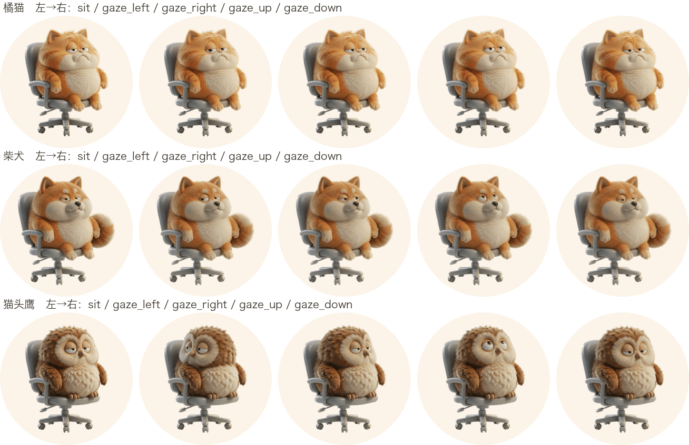

# 设计决策与踩坑

记录**为什么这么写**。很多写法看起来啰嗦或者反直觉，背后都有一个踩过的坑；不写下来，下一个人（包括三个月后的自己）会顺手「优化」回去。

格式：**背景 → 决策 → 理由 → 代价**。

---

## D-01 · 零权限路线

**背景**：要用「屏幕使用时长」做提醒，直觉方案是 Screen Time API 或 Accessibility 权限去监听键鼠事件。

**决策**：用 `CGEventSource.secondsSinceLastEventType(.combinedSessionState, eventType: kCGAnyInputEventType)` 读系统已有的空闲秒数。

**理由**：
- 这是系统公开 API，**返回一个数字，不注册任何事件监听**，因此不需要「辅助功能」授权，也不会出现系统弹窗
- 没有任何轮询开销，读一次就是一次属性查询
- `kCGAnyInputEventType` 的取值是 `UInt32.max`，Swift 里要写成 `CGEventType(rawValue: UInt32.max) ?? .null`

**代价**：只能拿到「距上次输入多久」这一个数。想知道「你在用哪个 App」做不到——但那也超出这个项目的需要。

---

## D-02 · 用 non-activating panel，而不是普通窗口

**背景**：提醒弹出时，用户正在打字/操作别的东西。普通 `NSWindow` 会抢走键盘焦点，你打一半的句子就跑到了弹窗上。

**决策**：`NSPanel` 子类，`canBecomeKey = false`、`canBecomeMain = false`，`styleMask` 含 `.nonactivatingPanel`，配 `orderFrontRegardless()`。

```swift
final class ReminderPanel: NSPanel {
    override var canBecomeKey: Bool { false }
    override var canBecomeMain: Bool { false }
}
```

**理由**：能盖在所有窗口之上（`.floating` / 强提醒 `.screenSaver`），但激活状态不变。

**代价（非常重要）**：**面板永远处于「窗口未激活」状态**，AppKit 会按这个状态**降级渲染系统控件**——`.borderedProminent` 按钮会变成白底白字，看起来像坏了。

所以：**所有按钮必须自绘**（`PrimaryButtonStyle` / `SecondaryButtonStyle` / `BareButtonStyle`），不要用任何系统按钮样式。

还有一个连带坑：`collectionBehavior` 必须含 `.canJoinAllSpaces` 和 `.fullScreenAuxiliary`，否则切到全屏 App 或别的 Space 时它就不见了。

---

## D-03 · 动画分三层

**背景**：最初只有「播放动作序列」这一层。结果动物在两次动作之间的空档里是一张完全静止的图，整体观感像贴纸。

**决策**：

| 层 | 实现 | 特点 |
|---|---|---|
| 待机层 | SwiftUI 修饰符，常驻 | 浮沉 `offset(y: ±2)` + 重心微移 `offset(x: ±1)`，**只用平移** |
| 表情层 | `eyeClosed` / `gaze` 状态 | 只覆盖坐姿，不打断事件层 |
| 事件层 | 姿态队列 | 会被 `react()` 抢占，播完接回 |

两个周期故意不同频：**浮沉 2.9s，横移 5.3s**。同频的话两个动作会锁相，看起来像机械抖动。

**只能用平移，不能用缩放和旋转。** 缩放（哪怕 1.022）和旋转（哪怕 ±0.9°）会让整张图每一帧都重新插值，在 126pt 里表现为整体发虚、毛发边缘出现第二层轮廓。平移在整数像素下只是搬纹理，零重采样。幅度取整数（1pt / 2pt），@2x 下正好落在物理像素上。详见 [D-17](#d-17--待机层不能用缩放和旋转)。

**理由**：「活着」的信号不是动作大，而是**永不完全静止**。三层之后，即使一次大动作都不播，动物也在动。

**代价**：待机层是 SwiftUI 动画，写 `cacheDisplay` 抓的是模型值而不是 CA 的插值，所以截图里看不出呼吸。要验证它生效，得对比 `visible=true/false` 两态的像素差（本项目实测 maxdiff=122）。

---

## D-04 · 逐帧动画必须硬切，不做交叉淡入

**背景**：切帧生硬，第一反应是加 `.transition(.opacity)` 让它淡入淡出。

**决策**：去掉所有 `.id()` / `.transition()` / `.animation()`，**硬切**。

**理由**：AI 生成的多帧**不是真正的中间帧**——衣服褶皱、羽毛走向、光照都在变。叠 85ms 的效果不是「过渡」，是**两只动物重叠闪一下**，比硬切难看得多。真正的 2D 逐帧动画（手绘中间帧的那种）才适合淡化。

**代价**：切帧是突然的。这个代价用「节奏设计」补——在短促动作前后插入 0.1~0.3s 的回落帧，让硬切落在动作的自然断点上。

### 闪屏的三个来源（全部修完才算不闪）

排查了很久，因为它看起来是一个问题，实际是三个：

1. **交叉淡入** — 两张姿态图叠加（见上）
2. **淡出时提前停动画** — `hideReminder()` 里先 `model.visible = false`，2.2% 的呼吸缩放瞬间归位，卡片在消失前「缩一下」。修法：把 `animator.reset()` 挪到淡出动画的 `completionHandler` 里，并加 `!panelVisible` 守卫（防止淡出期间又弹起来被误清）
3. **逐帧缩放抖动** — 见 D-05

---

## D-05 · 对齐工具的三代演进

这是本项目技术含量最高、也最容易做错的一段。

**背景**：素材是 AI 逐张生成的，每张里角色的位置和大小都有微小差异。不对齐，播放时角色会跳、会呼吸式缩放。

**决策**：三个工具并存，按场景选：

| 代 | 工具 | 锚点 | 适用 | 失效条件 |
|---|---|---|---|---|
| ① | `chair_align.py` | 椅子包围盒 | 换姿势幅度大 | 角色挡住椅子 → 只量到扶手 → 缩放完全错 |
| ② | `content_align.py` | 内容包围盒 | 同姿势只改局部 | AI 画大/小一点就被缩回去 → 体型每帧微动 |
| ③ | `fixed_align.py` | 固定窗口 | 机位没动的一整批 | 某帧 AI 真画错尺寸 → 该重生成，不是对齐 |

**为什么②不够**：橘猫的视线帧用①会得到小 11% 的头（视线帧和坐姿是同姿势，椅子被遮得更多），来回切就是「缩一下」。改用②后正常。但②的逻辑是「把每帧内容拉成参照的高度」——**它把 AI 的尺寸偏差当成需要修正的东西**。猫头鹰这批原始图机位根本没动（九帧暖色包围盒逐像素一致 `y=175..978`），AI 画的尺寸本来就是对的，被②一拉反而引入 1~3% 抖动。

**为什么③是对的方向**：**宁可发现某帧 AI 真的画大了然后重生成，也不让播放器替 AI 背锅。** `fixed_align.py` 会打印每帧的原始内容高，偏离参照 > 24px 就报警——这个报警的处置是重生成，不是调参数。

**代价**：换一批素材（比如换了 AI 模型出图，机位开始漂）时，③会整体失效，必须退回①或②。

**反向教材**：`warm_align.py` 试图用暖色掩码分离动物和灰椅子、按脚底带对齐。对猫头鹰这种圆胖形象彻底失败——**脚底宽度在站立时张开、坐着时并拢**，根本不是稳定基线。文件留着当教训。

---

## D-06 · AI 出图的一致性策略

**决策**：图生图 + `input_fidelity: "high"` + **三条硬约束写进提示词**。

1. 显式否定机位变化：「不要改变机位角度，不要推近或拉远，不要裁切画面，不要移动角色在画面里的位置和大小」
2. 锁定不该变的部分：「眼睛保持和原来一样的半睁、困倦下垂的样子，不要睁大」
3. 一次只改一件事

**代价**：**模型对「局部旋转」类指令几乎无响应**。猫头鹰歪头试了两版（提示词写死「整个头向左歪 25 度，是歪头不是转头」），两次都只让瞳孔偏了一点，头的中轴纹丝不动，第二版还把整体放大了。这类诉求要换表达方式——最后改用四向转头。

---

## D-07 · 视线跟随必须水平优先

**背景**：按夹角判定鼠标方位（`atan2(dy, dx)` 分四象限）最直觉。

**决策**：先判水平，再判垂直。

```swift
if abs(dx) > 60 { next = dx < 0 ? .left : .right }
else if dy > 40 { next = .up }
else if dy < -40 { next = .down }
else { next = .center }
```

**理由**：弹窗贴在**屏幕下缘**，鼠标几乎总在它上方。按夹角判定，`dy` 永远是正的一大坨，动物会一直「往上看」，左右跟随完全失效。

**代价**：鼠标在正上方且水平距离 < 60pt 时会判定为「看上面」，轻微不准，但符合直觉。

---

## D-08 · 「一致性」不等于「所有动物做同一个动作」

**背景**：需求原话是「三个形象都要兼容相同动作」。

**决策**：五个形象共用**三幕叙事结构**，但「卖力」那一拍按解剖学各表。

| 形象 | 第二幕 |
|---|---|
| 橘猫 / 小熊 / 水獭 / 柴犬 | 站起来伸懒腰 → 捶两拳 |
| 猫头鹰 | 站起来展翅伸懒腰 → 振翅两下 |

**理由**：猫头鹰是**栖鸟**，翅膀长在体侧、没有能握的手。让它握拳打人既不合解剖，AI 也画不出来——试过两版，出来都是「伸翅膀打招呼」（`punch1` 像指路，`punch2` 像招手），而且每版都把体型画小一圈（包围盒高 626 vs 其他 804）。

真正的「一致性」是**结构和节奏一致**，不是逼所有动物做同一个动作。落点是 `MascotRoutine.variants(for: style)`。

**代价**：每加一个解剖结构特殊的形象，就要写一套动作库。但动作库只是 `[(MascotPose, TimeInterval)]` 数组，成本很低。

### 振翅怎么用两帧做一次扇动

不需要中间帧：`flap1`（双翅抬到肩高、半张开）↔ `stand`（翅膀收拢贴回体侧）。两个位来回切，配上不对称的时长（抬 0.17s / 落 0.12s）就是一次扇动。

---

## D-09 · 开机自启用 LaunchAgent，不用 SMAppService

**背景**：`SMAppService.mainApp`（macOS 13+）是官方推荐方案。

**决策**：手写 `~/Library/LaunchAgents/io.github.xinyuanzi.xiehuier.plist`。

**理由**：`SMAppService` 在**未签名的本地自建 App** 上注册经常静默失败（需要有效的 bundle 标识与签名状态）。LaunchAgent 不依赖证书，本地跑稳定。

**细节**：
- `ProgramArguments` 用 `/usr/bin/open -a <bundle>` 而不是直接指可执行文件——走 LaunchServices，避免登录时被拉起第二个实例
- `LimitLoadToSessionType: Aqua` 只在图形登录会话启动
- **App 被移动过位置后 plist 里的路径会失效**，所以每次启动调 `refreshIfNeeded()` 重写一次，实现自愈

---

## D-10 · 会议检测用「设备占用」，不用进程名

**决策**：`AVCaptureDevice.isInUseByAnotherApplication` + CoreAudio `kAudioDevicePropertyDeviceIsRunningSomewhere`。

**理由**：判断进程名（Zoom / 飞书 / 腾讯会议）要维护一张越来越长的名单，而且漏一个就失效。设备占用是**行为信号**：有东西在用摄像头或麦克风，你就是在开会/通话，跟用什么软件无关。

**代价**：录屏、直播、录音也会被判定为「开会」，会误暂缓提醒。这个误判方向是安全的（宁可少提醒一次，也不要在你讲话时弹窗）。

**性能约束**：这两个查询都不便宜。**不要每秒查**——只在「距软提醒阈值剩 180s 内」或「有欠着的提醒」或「弹窗正开着」时轮询，且限频 5s。

---

## D-11 · 打卡口径从紧

**决策**：只有「专注时长已达软提醒阈值之后」发生的休息才算打卡。

```swift
if focusSeconds >= Double(prefs.focusMinutes * 60) {
    recordHabit()
}
```

**理由**：宽松口径下，随手离开一分钟就能刷满连续天数，解锁（5/10/15/30 天）立刻失去意义。**门槛本身就是这个机制的价值**。

同一个口径也在 `didRest()`（点「我去走走了」按钮）里执行，否则那个测试入口同样能刷天数。

**代价**：用户可能觉得「我明明站起来走了却没算」。所以设置页把规则写清楚了，状态栏也会在打卡成功时播报一句「打卡 N 天」。

---

## D-12 · 强提醒不做全屏遮盖，改「贴光标」

**背景**：最有效的提醒是全屏半透明遮罩——你什么都干不了，只能起来。

**决策**：不做。改成把窗口层级提到 `.screenSaver`，并让卡片**追随鼠标横向移动**，停在你光标旁边而不是正中。

**理由**：全屏遮盖会打断正在进行的工作（尤其会议共享屏幕时），代价远大于收益。而「贴着鼠标跑」有类似的存在感——你点到哪它跟到哪，但它不盖住你点的地方（`target = mouse.x - width * 0.5`，再夹在屏内）。

比例追随而非匀速：`step = clamp(dx * 0.16, -7, 7)`，越远走得越快，接近时自然减速。匀速会一顿一顿的。

**代价**：用户可以直接把它拖走。松手 1 秒后恢复追随（`lastDraggedAt` 判断），所以「拖走」只是暂时的。

---

## D-13 · 游走/追光标用 30fps，不用 60fps

**决策**：`Timer(1.0/30.0)`，每帧 2px。

**理由**：60fps 每帧 1px 和 30fps 每帧 2px 的**视觉速度完全一样**（60px/s），但每秒少唤醒 30 次窗口合成。菜单栏常驻的小工具不该为了 1px 的平滑度常年烧电。

---

## D-14 · 不用 Xcode 工程，用 `build.sh`

**决策**：`swiftc` 直接编 11 个文件 + 手写 `Info.plist` + `codesign -s -`。

**理由**：
- 贡献者只需要 Command Line Tools（约 1.5GB），不需要完整 Xcode（约 15GB）
- `.xcodeproj` 是二进制/易冲突的 XML，PR review 时是噪音
- 项目没有资源编译、没有 storyboard、没有多 target，`swiftc` 完全够用

**代价**：没有增量编译，全量编译约 10 秒（可接受）；没有 Debug 断点调试（用 `print` 和一次性测试工具代替）。

---

## D-15 · 无 bundle 的测试工具要注意资源路径

**背景**：`Tools/*/main.swift` 编出来是**裸可执行文件**，不是 `.app`。

**坑**：`Bundle.main.resourcePath` 此时等于**可执行文件所在目录**，不是项目的 `Resources/`。工具放在 `/tmp/ws4/run` 就会去 `/tmp/ws4/mascots/` 找素材，找不到就渲染出空白头像（而且不报错）。

**做法**：跑之前先 `cp -R Resources/mascots /tmp/ws4/`。写进 [DEVELOPMENT.md](DEVELOPMENT.md#56-出预览视频) 了。

---

## D-16 · 素材不入库，成品入库

**决策**：`Resources/frames/`（30MB AI 原始图）进 `.gitignore`；`Resources/mascots/`（12MB 成品）入库。

**理由**：成品是运行时必需（build.sh 要拷进 bundle），原始图只是重新对齐时的中间产物。想改素材的人自己重新出图即可，缺了不影响编译和运行。

补充：`.app`、`.backup/` 也排除。

---

## D-17 · 待机层不能用缩放和旋转

**背景**：待机层原本是「呼吸 `scaleEffect(1.0 ↔ 1.022)` + 重心摆动 `rotationEffect(±0.9°, anchor: .bottom)`」。数值都很小，看着不会出问题。实际在 126pt 的头像里，动物整体发虚，毛发边缘还多出一层淡轮廓——像重影。

**决策**：待机层**只用平移**。

```swift
// 浮沉 ±2pt，横移 ±1pt。幅度取整数，@2x 下正好落在物理像素上。
.offset(x: sway ? 1 : -1, y: breathe ? -2 : 0)
```

**理由**：

- 缩放和旋转会让整张图**每一帧都重新插值**。动画永不停，所以图像永远处在「非整数变换 + 重新采样」的状态，肉眼就是一直在发虚。
- 旋转尤其糟。0.9° 在 145pt 的图上，顶部有 2.3pt 的横向位移，等于整张位图被旋转着重采样——细密的毛发纹理最先崩，边缘出现第二层轮廓。
- **平移在整数像素下只是搬纹理，零重采样。** CA 只需要改变 layer 的位置，不需要重新采样 contents。

**代价**：「呼吸」变成了「浮沉」。视觉上依然有活着的感觉（人呼吸时肩膀也是上下动而不是整体缩放），但严格说不是呼吸。

**怎么验证**：这个坑**用 `cacheDisplay` 抓图测不出来**——离屏渲染走的是模型值，不经过 CA 的动画插值，抓出来永远是清晰的（实测去掉旋转后锐度只差 2%）。要验证只能看真实屏幕，或者用 `screencapture` 抓窗口（需要屏幕录制权限）。

> 教训：**凡是「永不停歇的动画」修饰符，都要先问一句「它会不会让位图每帧重新采样」。** 会，就不要用。这是小尺寸 UI 里最容易忽略的清晰度杀手。

---

## D-18 · 离开判定要拆成「暂停」与「归零」两档

**背景**：判定只有一档——`idle >= restSeconds`（默认 60 秒）就 `focusSeconds = 0`，顺手连弹窗一起 `hideReminder()`。看着符合「离开 >1 分钟就算休息」的需求。

实际用起来，用户报「计时周期突然归零了」。查下来不是 bug，是这条判定命中：读一段长文档 60 秒没碰键鼠，坐了两小时的累计当场抹掉。**漏记的恰好是工具最该管的那种久坐。**

**决策**：拆两档。

```swift
if idle >= prefs.awayResetSeconds {        // 真起身走开 → 清零 + 可能计一次休息
    ...
} else if idle >= prefs.restSeconds {      // 手停了人还在 → 冻结，不清零
    awayPaused = true
} else {
    awayPaused = false
    focusSeconds += 1
}
```

`awayResetSeconds = max(awayMinutes × 60, restSeconds + 60)`。取 `max` 是为了防两个阈值被调反——反了会变成「先归零再暂停」的死逻辑。

**理由**：

- **「没碰键鼠」和「人走了」不是同一件事。** 系统空闲时长只看得到前者。看文档、看视频、开会听人讲、盯着一个问题想——全是零输入，但人稳稳坐在椅子上。用 60 秒把它们判成离开，等于系统性地低估久坐时长。
- **冻结比清零更接近事实。** 暂停期间数字停住但保留进度，回来接着数。语义上依然满足「离开就不算久坐」（确实没在累加），只是不再销毁历史。
- **一个阈值管两件事，两件事都会做错。** 阈值调小 → 误伤看文档；调大 → 离开 4 分钟还在累加。拆开之后两个参数各自只负责一件事，用户想怎么调都不打架。

**代价**：用户在暂停期间会看到数字不动，第一反应是「又坏了」。所以菜单第一行加「· 暂离暂停」明说。另外暂停期间弹窗不再自动消失（旧逻辑顺手 hide 掉了），回来能看见提醒——但也意味着人不在这 5 分钟里，弹窗会在屏幕下缘自己游走。

**没做的**：没把 `focusSeconds` 落盘。重启归零仍在，属已知行为，已写进 README 的 FAQ。

> 教训：**凡是用「零输入」推断「有人/没人」的判定，都要问一句「这个人在座位上但手停着的情况有多常见」。** 久坐提醒、在线状态、自动锁屏、离开打卡——全踩这个坑。

---

## D-19 · 用屏幕状态替代时长猜测

**背景**：D-18 把离开判定拆成「冻结」与「归零」两档，但两档的边界仍然只是时长——5 分钟。这是个假边界：**传感器只有一个读数，而读数背后的现实有四种**（读长文档、盯着问题想、起身倒水、开会听人讲），时长分不出来。

后果很直接：看一集 40 分钟的剧，`idle` 连续超过 5 分钟，判成离开、清零。而那 40 分钟人一直坐在椅子上——**正是这个工具最该提醒的久坐**。阈值调到 30 分钟也没用，只是把误判推迟。

**决策**：把「确凿离开」交给屏幕状态，时长退回去只管「冻结」。

```swift
let away = Presence.isAway        // 熄屏 || 锁屏 || 不在控制台
if away || idle >= prefs.awayResetSeconds { 清零 }
else if idle >= prefs.restSeconds { awayPaused = true }   // 冻结
else { focusSeconds += 1 }
```

```swift
static var isAway: Bool { displayAsleep || sessionInactive }

static var displayAsleep: Bool { CGDisplayIsAsleep(CGMainDisplayID()) != 0 }

static var sessionInactive: Bool {
    guard let info = CGSessionCopyCurrentDictionary() as? [String: Any] else { return false }
    if let locked = info["CGSSessionScreenIsLocked"] as? Bool, locked { return true }
    if let onConsole = info["kCGSSessionOnConsoleKey"] as? Bool, !onConsole { return true }
    return false
}
```

**理由**：

- **「屏幕亮不亮」是系统自己的离开判定**，比我们拍的阈值可信。系统按用户设的 `displaysleep`（本机 10 分钟）熄屏，我们直接借用这个结论，不用自己再猜一遍。
- **看视频和开会时屏幕一定亮着**。播放器会持有 prevent-display-sleep 断言，会议软件同理。所以这两类最容易被误判的场景，天然被排除在「归零」之外。
- **两条 API 都不需要授权**。不碰屏幕内容、不碰辅助功能，只问「屏熄了吗 / 锁了吗」，隐私成本和 `secondsSinceLastEventType` 同级。
- **错误代价仍然不对称**。熄屏/锁屏漏判（系统没熄屏就离开了）→ 多记一段坐着时间，回来弹一次提醒，可恢复；时长误判（看视频被清零）→ 抹掉真实久坐，不可恢复。

**为什么还要订阅系统通知**：只靠 tick 轮询不够。屏幕睡着时 App Nap 可能把定时器压慢甚至压停，等你回来第一次 tick，`isAway` 已经变回 false——「睡着」这个状态从头到尾没被看见，该清的一次也没清。所以 `screensDidSleepNotification` 一到就立刻处理，事件驱动不看运气。`screensDidWakeNotification` 也挂同一个处理，纯粹当漏事件的补偿（此时 `focusSeconds` 已是 0，重复调用是空操作）。

顺带把 `handleWake` 和 `handleAway` 合并成一个入口：合盖睡眠、熄屏、锁屏都是「人走了」，没理由走两套代码、两种打卡口径。

**代价**：

- `awayMinutes` 的语义变了。它原来是主力判定，现在只是「用户把屏幕设成永不休眠」时的兜底，默认值从 5 提到 30——**5 会先于系统息屏（10 分钟）触发，等于把 D-18/D-19 想修的问题原样带回来**。设置项改名为「兜底归零」。
- 熄屏这个信号在**合盖**场景拿不到（系统直接睡眠，`tick` 停摆），靠已有的 `didWakeNotification` 兜。两条路都指向同一次清零，不冲突。

**怎么验证**：`CGDisplayIsAsleep` 只在屏真的熄了才返回 1，日常开发时测不到真分支。写了一个独立小工具打印 `displayAsleep` / `locked` / `onConsole` 三个值，熄屏和锁屏各试一次即可——比反复重启 app 快。

> 教训：**别用「代理指标」的阈值去替代「直接信号」。** 时长是「在线/离开」的代理，屏幕状态几乎是直接信号。代理指标永远只是猜，一旦有更直接的信号可用，就该换掉，而不是继续调阈值——调阈值只是把猜错的位置挪一挪。

---

## D-20 · 会议中要照常计时，而不是冻结

**背景**：D-19 把「屏幕亮着但手停下」一律冻结，理由是「人还在座位上，别抹进度」。这条对读文档、看视频成立，对会议**反向成立**——开会时人确实在座位上，而且一坐就是一小时起，那是这个工具最该出手的场景。冻结之后累计停在原地，到点也不提醒，等于给最长的久坐按了静音。

同一轮还暴露出第二个问题：熄屏/锁屏直接清零太粗暴。误触一次 `⌃⌘Q`、屏幕刚睡就被碰醒，两小时的累计当场归零。

**决策一**：会议中（摄像头或麦克风被占用）照常 `focusSeconds += 1`，只把弹窗推迟到会后。

```swift
} else if idle >= prefs.restSeconds {
    if prefs.meetingAware && meetingBusy {
        awayPaused = false          // 会中：人在座位上，继续计时
        focusSeconds += 1
    } else {
        awayPaused = true           // 手停人还在：冻结
    }
}
```

**决策二**：离开必须**持续**够久才结算（`awayMinSeconds = 30`；v0.12.10 起改为 60 秒，见 D-33）。熄屏/系统睡眠的瞬间由 `screensDidSleepNotification` / `willSleepNotification` 记下 `awaySince`，唤醒时按实际时长结算，不足 30 秒什么都不做。

**理由**：

- **会议是长坐的高发场景，不是休息场景。** 冻结的隐含假设是「手停了 = 可能不在了」，而会议检测给出的是相反证据：摄像头/麦克风正被占用，人几乎必然在桌前。有反证时就不该继续套用默认假设。
- **「不打扰」和「不计数」是两件事**，v0.9.3 把它们混成了一件。会中不该弹窗（打断比久坐更烦），但该继续记账，会后补发——`deferredPending` 本来就是干这个的。
- **清零是不可逆操作，所以要有时间下限。** 30 秒这个数取得随意但方向明确：短于它的离开不构成一次休息，也就不该有清零的资格。误触的成本从「全丢」变成「无感」。

**代价**：

- 会议检测依赖摄像头/麦克风**被占用**。线下围坐开会、戴着耳机用手机开会，都识别不到，仍按冻结处理。这是信号本身的边界，不是实现缺陷。
- `refreshMeetingState` 多了一个轮询触发点（手停下时），代价是每次停下后每 5 秒查一次 AVFoundation + CoreAudio。频率已用 `lastMeetingCheck` 限流。
- 「会议中继续计时」意味着会后可能立刻弹出一个「已坐 2 小时」的强提醒。这是故意的——会后正是最该起来走动的时候。

> 教训：**「默认假设」要能被反证推翻。** 「手停了多半不在了」是个合理的默认，但一旦有更具体的证据（摄像头在用、麦克风在用），就必须让更具体的证据接管，而不是让默认假设一路覆盖下去。

---

## D-21 · 去掉冻结状态，只有离开才清零

**背景**：D-20 把「会议中冻结」改成了照常计时，但保留了「非会议时手停就冻结」。用户接着指出两件事：

1. 开会与否，我用什么判断？答案是**只有一条正向证据**（摄像头/麦克风被占用），线下围坐、手机开会都测不到。
2. 跟旁边人说话、读文档停下来想，很容易超过 5 分钟——可人明明在座位上。

两条合起来否定了「冻结」这个状态本身：它把「未知」当成「人走了」，而未知才是常态。

**决策**：删掉 `awayPaused`。屏幕亮着就一直 `focusSeconds += 1`，只有「确凿离开」（熄屏/锁屏/睡眠持续 ≥ 30 秒）才清零。

```swift
if !away { focusSeconds += 1 }          // 手停不停都算，人还在座位上

// 静默只压制升级，不影响记账
inSilence = !away && !inMeeting && idle >= prefs.silentSeconds
let holdBack = away || inMeeting        // 只有确凿证据才压住弹窗
```

**理由**：

- **屏幕没熄这件事，本身就是系统在说「人还在」。** 系统按 `displaysleep`（本机 10 分钟）熄屏，比我们拍的 1 分钟/5 分钟阈值都更贴合「真离开」。已经有更宽容、更权威的判据了，没必要再叠一层自己拍的阈值去覆盖它。
- **冻结的代价是不可逆的漏记，弹窗过多的代价只是多点一次。** 两侧代价根本不对称。看两小时视频、开一小时线下会，冻结会让工具在最该响的时候全程静音。
- **「未知」不能默认成「否」。** 这是本轮最核心的一处逻辑错误：`meetingBusy == false` 的含义是「没检测到会议」，不是「不在开会」。把它当反证用，等于让举证责任落到用户头上——而用户根本没法自证。

**代价**：

- 人离开但屏幕没熄（没锁屏、恰好没到熄屏时间），会多记几分钟，回来可能立刻弹一次提醒。可接受：点一下就好，而且屏幕一般 10 分钟内会熄。
- 线下会议、手机开会期间会照常弹提醒（检测不到会议）。用户可以手动「暂停 1 小时」，或者干脆让它弹——反正久坐是真的。
- 少了一个「暂停/继续」的中间态，代码反而短了（`awayPaused` 的全部引用删除）。

**静默的新定位**：手停超过 `silentMinutes`（默认 5）且不在开会 → 提醒照弹，但不升级、不追鼠标。它只回答「要不要打扰得更凶」，不回答「算不算坐着」。**把「打扰强度」和「是否计时」彻底解耦，这是本轮真正的修法**——前两版一直在同一个混淆上打转。

> 教训：**任何「因为不确定，所以不记录」的设计都要先算一次期望损失。** 不确定时该往哪边倒，取决于哪种错误的代价不可逆。这里冻结（漏记）不可逆，多记可逆——所以默认必须选「多记」。同类判断：日志丢了不可逆、多写一条可逆；转账少记不可逆、多记可退。

---

## D-22 · 归零兜底改成长静默：能删数据的只有确凿信号

**背景**：v0.9.5 删掉了「冻结」，却留了一条自相矛盾的尾巴——`awayMinutes`（默认 30 分钟）兜底：屏幕亮着、手停了半小时，就把累计清零。名义上是照顾「屏幕设成永不休眠」的人，实际上撞在同一个坑里：**时长是代理指标，代理指标不该有权删数据**。

最典型的误伤是看视频。播放器会持有 display sleep assertion，屏幕根本不会熄，`idle` 可以一路涨到一小时以上。于是「连续看 50 分钟视频」——最该被记录的久坐场景——会在第 30 分钟被清零，而且用户完全不知道自己被清零了。

**决策**：`awayMinutes` → `longSilentMinutes`，语义从「归零」改成「先不弹」。

| 手停时长 | 累计 | 弹窗 | 升级 |
|---|---|---|---|
| < 5 分钟 | 照涨 | 到点就弹 | 正常升级 |
| 5–30 分钟（静默） | 照涨 | 到点就弹 | 不升级、不追鼠标 |
| ≥ 30 分钟（长静默） | **照涨** | **先不弹**，手一回来立刻补发 | — |
| 熄屏 / 锁屏 ≥ 30 秒（v0.12.10 起 60 秒，见 D-33） | **清零** | 收窗 | — |

```swift
// 累计：只要屏幕亮着就记，没有任何时长阈值能删它
if !input.away { focusSeconds += min(delta, deltaCap) }

// 长静默只拦「弹」，不拦「记」
if input.away || input.inMeeting || inLongSilence {
    deferredPending = true
} else {
    event.shouldShowReminder = true
}
```

**理由**：

- **两侧代价不对称，这是第四次用同一条判断标准。** 误判「人走了」的代价是多记几分钟、回来多点一次；误判「人在」的代价是删掉一段真实久坐时间，且不可逆。永远选可逆的那边。
- **看视频恰恰是这个工具存在的理由。** 连续两小时不动，正是要提醒的场景。旧兜底把它当成「要清理的噪音」，方向完全反了。
- **不需要第二套逻辑。** 「不确定时先不打扰、但继续记账」和 D-21 的静默完全同构。多一条独立规则就多一处要维护的分叉。

**代价**：

- 屏幕设成永不休眠 + 人真走了三小时 → 回来看到「已坐 3 小时」，手一动立刻补弹一次。数字不精确，但方向没错（你确实坐下去了很久），而且不会一声不响地把时间吃掉。
- 理论上会出现「人不在、数字还在涨」。用菜单里那句「手停 32 分钟，先不弹」说明白，比默默清零好接受。

> 教训：**推翻一个方案时，要把同源的其它实现一起找出来。** v0.9.5 删了 `awayPaused`，却把同一个错误换了个变量名留在 `awayResetSeconds` 里——因为当时只盯着用户指出的那一处。判据（「时长不能删数据」）一旦成立，就该全仓搜一遍还有谁在用它，而不是等下一次反馈。

---

## D-23 · 落盘只续数字，不补间隙

**背景**：计时只存在内存里，重启即归零。这是用户最初报的「为什么计时归零」的另一种形态——那次是判定错，这次是根本没存。

**决策**：`SessionStore` 每约 10 秒把三个数写进 `~/Library/Application Support/XieHuiEr/session.json`；启动时读回来，按快照的新鲜程度决定续什么。

| 字段 | 续的条件 | 说明 |
|---|---|---|
| `focusSeconds` | 快照 ≤ 10 分钟前 | 超过就不续，从 0 开始 |
| `daySitSeconds` | 同一天 | 与时间无关，今天的总量就是今天的 |
| `todayCount` | 同一天 | 防止「重启刷满 8 次」 |

**永远不加「关闭期间」的时间**。

**理由**：

- **恢复时补 gap 等于编造。** 加上两小时，就等于声称「我不在的时候你也在坐着」。工具一旦开始编数字，之后所有数字都不再可信——而「计数可信」是这个项目的全部价值。
- **10 分钟这个窗口选的是「像崩溃」而不是「像离开」。** 短于它，大概率是重启、更新、崩溃；长于它，人可能已经吃过饭回来了，续上一个陈旧数字比归零更误导。
- **用 JSON 文件而不是 `UserDefaults`。** 排查时能 `cat` 一眼，用户想重置也能手动删掉。`UserDefaults` 藏在 plist 二进制里，两头都做不到。

**代价**：

- 关机一夜回来从 0 开始。听上去和「bug 归零」没区别，但这一次是真的不知道——归零比编造诚实。README 的已知缺陷里写清楚。
- 每 10 秒一次小文件写盘，代价可忽略；写失败静默忽略，顶多丢十几秒精度。

> 教训：**「让数字不丢」和「让数字补上」是两件事，做前者就够了。** 顺手把后者也做了，用户短期会更满意，但从那一刻起数字就只是估算。宁可承认不知道。

---

## D-24 · 判定逻辑抽成纯函数，用时间轴用例兜住

**背景**：v0.9.2–v0.9.5 连续四个版本改在同一段 `tick()` 里，每次都是「改代码 → 重启 → 盯菜单栏 → 用户第二天报新问题」。合盖 8 小时、看视频 50 分钟、跨零点这类场景，人工根本没法验。

**决策**：把 `(idle, away, inMeeting, delta, panelVisible, canRemind) → (累计 / 结算 / 静默 / 补发)` 抽成纯结构体 `PresenceMachine`，不读时钟、不碰 AppKit；输入输出都是值类型。配套 `Tools/PresenceTest` 用时间轴回放，`Tools/run_tests.sh` 一条命令跑完。

```swift
mutating func step(now: Double, input: PresenceInput,
                   thresholds: PresenceThresholds) -> PresenceEvent
```

**理由**：

- **不可测的状态机一定会退化。** 四个版本的经验已经说明了：同一处逻辑改四次还改不对，问题不在思路而在验证手段——没有测试的判定逻辑，每次修改都是在赌。
- **纯函数让「快进」成为可能。** 合盖 8 小时只需要把 `now` 往前跳 28800，不用真的等一夜。
- **`delta` 参数把「不确定」显式化了。** 定时器被 App Nap 拉长、被系统睡眠挂起，同一段代码用 `min(delta, 3)` 明确回答「这段时间我不认」。以前这是隐含在 `+= 1` 里的一个 bug。

**代价**：

- 多了一层间接。AppDelegate 从「自己算」变成「喂参数、看结果、执行动作」。
- 15 组用例（51 项检查）要随判定变化一起维护。这是好事：改判定不动用例，说明改的是别的东西。

> 教训：**能写成纯函数的判定，不要留在 `AppDelegate` 里。** 判据很简单——它要不要读时钟、要不要碰 UI？都不要，就抽出来。抽出来之后，测试成本从「重启盯半小时」降到「一条命令 3 秒」。

---

## D-25 · 视线帧只动眼睛，不转头——幅度不一致比幅度小更糟

**背景**：给柴犬做四向视线时，前两张（`gaze_left` / `gaze_right`）与 `sit` 的像素差只有 1635 / 1828，而橘猫同项是 5337。我一度判断「幅度太小等于没做」，把提示词从「只动眼珠」改成「整颗头往右转 10~12 度」。

结果更糟：那张图改掉了 33478 像素（橘猫才 5337），但**脸型被整颗重绘了一遍**，方向感反而没出来。原因很直接——柴犬的定妆照是「3/4 侧脸、鼻子朝画面左」的构图，在 AI 眼里这就是一张正面肖像，让它「往右转头」等于让它重画一张脸。

**决策**：视线帧一律**只动眼球和眼皮，提示词里明确禁止转头**；接受它是「微表情级」的效果。

**理由**：

- **112pt 的容器里，微表情的性价比永远高于大动作。**
- **幅度不一致比幅度小更糟。** 四向里如果有的转头、有的不转，循环起来就是抽搐。宁可四个方向一样轻。
- **上下比左右容易做。** 眼眶的垂直空间足够，眼皮还能配合（往上看抬一点、往下看压一点）；左右被 3/4 侧脸和半睁眼压得很窄，硬做只能靠重绘。

**代价**：左右两个方向的观感明显弱于上下。这是构图决定的，不是提示词能修的。

> 教训：**先量基线，再判断「够不够」**。我这次差点因为一个拍脑袋的绝对阈值（「差异 < 1 万像素算无效」）把已经合格的图重做一遍。基线的正确取法是看同项目里已经验收过的同类素材，不是看一个通用数字。

### 后续实测：视线跟随其实只有猫头鹰成立

上面那段判断建立在两处错误对比之上，当天晚些做了修正：

**错误一：拿 raw 对 raw 跟别人成品对成品比。** 我量柴犬是「raw 出图 vs `sit_raw`」（1600–3300），却量橘猫是「成品 vs 成品」（5337）。成品之间差了一个 `fixed_align` 的独立重采样，本身就制造噪声。同口径重测：

| 形象 | 成品间差异 | 112pt 下能否读出方向 |
|---|---|---|
| 猫头鹰 `d` | 17003 / 32774 / 26548 / 20859 | **能**，四个方向一眼可辨 |
| 橘猫 `a` | 5445 / 5377 / 5339 / 5710 | 基本不能 |
| 柴犬 `e` | 6265 / 5733 / 5808 / 6208 | 基本不能 |

**错误二：以为「像素差够大」就等于「看得出方向」。** 橘猫和柴犬的数字几乎一样，可两只在 252px 的真实卡片尺寸下、四个方向并排都分不清。猫头鹰能分开，靠的不是差异像素多，而是**眼睛大、眼白面积够**——虹膜在眼眶里挪 1/4 个宽度，缩到 112pt 还剩得下；柴犬那种「一条缝」的眼睛，挪满整个眼眶也只剩两三个像素。



> 上图按卡片真实尺寸渲染（圆 126pt、内容 112pt，@2x）。橘猫和柴犬两行，五张并排几乎一模一样；猫头鹰的 `gaze_left` / `gaze_up` / `gaze_down` 一眼能认出来。

所以这条决策的适用范围要收窄：**「只动眼睛不转头」是对的，但它只能保证「不做坏」，不能保证「做得出效果」。视线跟随能不能成立，在定妆照定稿那一刻就已经决定了。**

**对路线图的影响**：原计划给水獭、小熊补四向视线（8 张），按现有画风做出来大概率是白花钱。要做就得先定一条形象规格——**眼睛要有可见眼白，虹膜宽度不低于眼睛宽度的 1/3**——否则不如不做，让 `MascotPose.gaze*` 一直走 `fallbackName` 退回 `sit`。

---

## D-26 · 「按着鼠标」不等于「在拖窗口」，窗口移动必须用坐标反推来源

**背景**：v0.12.1 修完「12 秒计时器没创建」之后，用户再测，卡片弹出来了、也切到了伸懒腰姿态（标题变成「喂——还在坐？」，说明 `escalate()` 确实跑了），**但还是不动**。

排查过程：
1. 先确认偏好设置：`wanderEnabled = 1`、`escalateSeconds = 12`，都不是配置问题
2. 确认 `activeScreen` 弹窗那一刻就固定了，不会中途变 nil，`wanderRect` 必然有效
3. 确认卡片根布局是 `.frame(width: 286, height: 292) + .padding(28)` 固定尺寸，`maxX` 不会算成负数
4. 于是 `Wander.stepX` 不可能返回 nil、`setFrameOrigin` 必然被调用 —— 那为什么不动？

问题出在**「谁移动了窗口」这个判断上**。`makePanelIfNeeded()` 给面板注册了 `NSWindow.didMoveNotification`，用来在用户拖走卡片时让自动行为让路。而游走是 30fps，**每帧 `setFrameOrigin` 都会触发这个通知**（`Tools/MoveNotifyTest` 实测：30 帧触发 30 次）。AppKit 对「定时器挪窗口」和「用户拖窗口」发的是同一个通知，通知里也不带任何来源字段。

原来的处理函数只能拿 `NSEvent.pressedMouseButtons` 猜：

```swift
let dragging = (NSEvent.pressedMouseButtons & 1) == 1
guard dragging else { return }
...
stopWandering()
```

**「按着鼠标」不等于「在拖窗口」。** 用户戳一下卡片、点完某处手指还没抬起来、甚至只是握着鼠标没松手——只要按键状态是 down，游走的第一帧移动就被判成拖拽，`stopWandering()` 直接停掉。而软提醒阶段没有任何恢复路径（那时的善后只处理强提醒的 `startChasing`），卡片就此永久定在原地。

**决策**：改用**坐标比对**判断移动来源——位置正好等于上一帧自己设的那个点，就是自动移动；偏离才算用户拖的。

```swift
static func isAutoMove(actual: CGPoint, expected: CGPoint,
                       tolerance: CGFloat = 1.5) -> Bool {
    abs(actual.x - expected.x) <= tolerance && abs(actual.y - expected.y) <= tolerance
}
```

**理由**：

- **通知里没有的信息，不要用别的信号去猜。** 这里的「别的信号」和要判断的事之间没有因果关系，只是碰巧相关。猜错的代价是功能彻底失效，而且失效得无声无息——卡片就是不动，没有任何报错。
- **坐标是我们自己写进去的，是唯一可靠的自证。** 容差 1.5px：比坐标取整误差大，比用户拖动的最小位移小。
- **带插值的动画（`dodge`）没法逐帧比对**，因为中途坐标都不是终点。这段用时间窗 `autoMoveUntil` 整体免检，而不是硬凑一个判据。

**代价**：多一个 `autoMovedTo` 状态要维护——每条 `setFrameOrigin` 都得同步写。漏写一处的后果和原来的 bug 一样。

### 顺带修的两处，同一个病根

排查时发现另外两条路径也会把游走停死、且不恢复：

- `dodge()`（连戳三次躲开）里 `stopWandering()` 之后什么都不做。**用户想让卡片动，戳它反而让它不动了**——这是个后门
- `handlePanelMoved` 的善后只处理 `urgency == .strong`（恢复追光标），软提醒被拖一次就永久定住

### 更根本的一层：不要指望每条路径都记得善后

停游走的路径有三条（拖走、躲闪、升强提醒），将来还可能加第四条。要求每条路径都自己恢复，漏一个就是「卡片定住」——而这恰好是用户最先能看见的故障。所以 `tick()` 里加了一句自愈：

```swift
if panelVisible, model.urgency == .soft, model.stage == .stretching,
   prefs.wanderEnabled, wanderTimer == nil, chaseTimer == nil,
   Date().timeIntervalSince(lastManualMoveAt) > 1.5 {
    startWandering()
}
```

每秒问一次「现在该不该动」，成本是一次判断。1.5 秒静默期留给手动干预：刚被拖过就先别抢回来。

> 教训：**「状态」和「事实」要分清。** `pressedMouseButtons` 是一个状态，它推不出「正在拖窗口」这个事实；`autoMovedTo` 是我们自己写下的事实，可以反推出「这次移动不是我干的」。上一版（D-21 附近）也栽在同一个坑里——用 `idle` 时长去猜「人还在不在座位上」。**推测出来的状态可以调强调制，不能当开关，更不能当事实来源。**

---

## D-27 · 重影是「透明窗口漏擦」，不是交叉淡入——而且不能用重建视图来修

**背景**：用户发来截图，圆形头像里同时出现：一把清晰的黑色办公椅、一只实心橙色站姿胖猫、一个半透明的浅色猫头浮在它头顶。用户报「有重影」。

**先排除掉的可能性**（按顺序）：

1. **两个 Image 同时渲染？** 不是。`body` 里只有一个 `if let image = image(for: displayPose)`，设置页那处预览在另一个窗口里，且不带米色圆
2. **交叉淡入？** 不是。写工具用 `CGWindowListCreateImage` 连续抓帧，用「椅子区域深色像素数」当探针：切换是 **一帧内完成**（684 → 890、881 → 676），没有中间过渡帧。逐帧数值只有呼吸动画造成的 ±15 波动
3. **帧序列里混进了别的姿态？** 不是。探针在 sit/stand 交替下只有两个稳定台阶

**结论：残留在窗口合成层，不在视图树里。** 这解释了为什么抓窗口图像抓不到——抓到的是 backing store，那已经是清理过的最终内容；残影只存在于屏幕合成那一步。

**成因**：面板是 `isOpaque = false` + `backgroundColor = .clear`。SwiftUI 做增量重绘时判断不出「这块区域上一帧有内容、这一帧没有了」（椅子只在坐姿家族里存在），擦除就被跳过，上一帧留在原地。

**修法**：给 `NSHostingView` 设 `layerContentsRedrawPolicy = .onSetNeedsDisplay`，内容一变就重绘。

> 注意不能设 `.crossfade` —— 那是主动做交叉淡入，正好是重影的成因。

### 两个试过但必须记下来的错误修法

这两个都「看起来更彻底」，实际都会破坏别的东西。抓帧验证时才暴露：

| 方案 | 结果 |
|---|---|
| `Image` 加 `.id(displayPose)` 强制重建 | 换帧确实重建了，但重建把外层 `repeatForever` 的呼吸动画一起掐断。实测切到站姿后像素分布**恒为 847**（零波动），观感是「站起来之后变成一张静止图片」 |
| `.transaction { $0.animation = nil }` | 换图硬切了，但它把待机层的 `offset` 动画一起吃掉，同样测到**恒为 600** |

**正确写法是 `.animation(nil, value: displayPose)`** —— 只在这一个值变化时禁用动画，其余属性的动画不受影响。改完实测：sit 段 11 个不同取值、stand 段 13 个，切换仍是硬切。

**顺带**：`.scaleEffect(1)` 看着是空操作，SwiftUI 仍会为它创建变换层。橘猫和柴犬的 `mascotZoom` 都是 1.0，改成 `ZoomIfNeeded`（值为 1 时不调用），少一层合成。

> 教训：**「更彻底」不等于「更对」。** 强制重建、清空事务都是重手段，它们的副作用是打断常驻动画——而这个应用的核心观感恰恰是那个一直在跑的呼吸。判断修法好不好，得看它会不会伤到别的层，不能只看目标问题有没有消失。这次的验证方式也值得复用：**用像素统计当探针**（椅子区域深色像素的逐帧数值），比肉眼看截图可靠，比「用户再试一次」快。

---

## D-28 · 「再等 N 分钟」必须有次数上限

**背景**：卡片上那个「再等 5 分钟」按钮，实现只有一行 `machine.rewind(to: 阈值 - N)`。它把累计往回拨 5 分钟，到点再弹，再拨 5 分钟。**理论上可以一直拨到天亮。**

后果不是「用户体验不好」，是这个工具唯一的产品承诺被磨掉了：软提醒 60 分钟、升级 78 秒游走、强提醒 90 分钟追鼠标——这条「越来越烦」的升级链，最后一环靠 `focusSeconds` 爬过 `strong` 才会触发。累计被无限回拨，强提醒永远升不上来，前面所有设计都变成装饰。

**为什么这不是「用户自己选的」**：用户点「再等 5 分钟」时的意思明确是「五分钟后再说」，不是「今天别提醒我」。如果真不想被提醒，菜单里有「暂停 1 小时」——一个明说的、有明确时长的出口。把「再等」做成无限顺延，等于把一个「顺延」按钮偷偷变成了「永久关闭」，而界面上没有任何地方写着这件事。

**方案**：`PresenceMachine.snoozeStreak` 记这一轮推了几次，上限 3 次（= 15 分钟顺延额度）。满了之后卡片不再给按钮，位置换成一句「推了 3 次了，这次我真的不走」。

三条设计上的取舍：

1. **为什么是 3 次**：一次 5 分钟，三次 15 分钟。「我手头这点事马上完」在现实里的量级就是这样。再多就不是「马上完」了
2. **为什么把按钮去掉，而不是改成「再等 20 分钟」**：加长顺延时间并不封死后门——20 分钟一轮照样能无限推。而且顺延时间变长反而更像「被允许继续坐」
3. **为什么留一句话而不是留空**：卡片高度固定 292pt，去掉按钮不会让它变矮，只会空出一块。空着比明说更奇怪——用户会以为界面坏了。这句话的作用是**解释按钮去哪了**，而不是补一个更狠的按钮

**为什么记在判定机里而不是 UI 里**：次数的生命周期就是「这一轮」的生命周期。`reset`（点我去走走了）、`settle`（熄屏够久、确凿离开）、`rolloverDay`（跨零点）、`adopt`（重启续盘）四条路径都必须清它。放在 `AppDelegate` 或视图里，就有了「哪条路径忘了清」的可能——而这正是 D-24 把判定逻辑抽成纯结构体的理由。放在判定机里，四条路径各加一行，`PresenceTest` 第 18 组逐条钉住。

**`rewind` 本身不计数**：回拨和「推诿次数」是两件事。菜单里将来还可能有别的入口需要回拨但不该算作「推掉一次」，把计数塞进 `rewind` 会把两个语义永久捆死。

> 教训：**每一个「顺延 / 跳过 / 忽略」按钮都是产品后门。** 加这类按钮时先问一句：连点一百次会怎样？如果答案是「核心功能失效」，那它就不是按钮，是开关——而开关必须在界面上写着，或者被护栏挡住。

---

## D-29 · 「我去走走了」是一句宣称，不是一道命令

**背景**：用户提了一条规则——「点了『我去走走了』，但屏幕没熄、鼠标键盘还在动，那就继续累计，5 分钟后再提醒」。

原来的 `didRest()` 是「打卡 + 清零 + 收卡片」一步到位。问题在于：**用户点完按钮，手还放在键盘上继续打字，这种情况一点不少见**（想先把这句话打完、先把这个函数写完、先把这条消息发出去）。这时打卡照记、计时照清，下一轮又从 0 开始算 60 分钟。

结果是一个**假按钮**：按一下，系统就认为你休息过了。打卡天数和累计时长同时被污染——而这两件事恰好是这个工具唯一值钱的部分。

**根因**：把「用户点按钮」当成了「用户已经起身」这个事实。但这只是**一句宣称**，不是**一次观测**。D-26 的教训是「状态推不出事实」，这里是同一类错误：**意图推不出结果**。

**方案**：点击只算「宣称要去休息」，开一个 5 分钟观察窗口，三条出路：

| 窗口内发生什么 | 判定 | 动作 |
|---|---|---|
| 熄屏 / 锁屏够久 | 真休息 | 清零 + 打卡（走原来的 `settle` 路径） |
| 手停够 60 秒 | 真休息 | 清零 + 打卡 |
| 到点键鼠一直在 | 其实没走 | **累计一秒不减**，立刻再弹，标题换「你好像没走开」 |

**为什么 60 秒**：这是原始需求里就有的「离开 1 分钟算休息」，不是新拍的数。

**为什么这条不违反 D-19「手停不算离开」**：D-19 约束的是「**没被告知**的情况下，手停多久都不能删数据」。这里的前提反过来了——用户刚刚明确说了要去休息，此后的沉默就是佐证，不是猜。**没点过按钮的沉默依旧什么也证明不了**，两条判定互不干扰，测试里各有一组用例钉着。

**为什么窗口到点必须换文案**：5 分钟后卡片自己冒回来，不解释的话用户第一反应是「我明明点过休息，这是 bug 吧」。这两句文案不是为了俏皮，是为了让「为什么又来了」当场有答案。同理，文案不能写成「你没动」——点按钮的人确实想休息，只是没走成。

**为什么开会时不弹**：窗口到点时如果麦克风/摄像头还占着，走正常的「会后补发」路径（文案回落成「刚才在开会吧？」）。在会议中途弹窗比丢一句解释性文案糟糕得多。

**为什么窗口不跨重启**：进程都没了，那五分钟里人在不在我们不知道。按 D-23 的口径，不知道就不编。

> 教训：**按钮收到的是意图，不是结果。** 任何「我做了 X，所以状态变成 Y」的按钮，都要问一句：用户点完之后，身体真的跟着动了吗？「完成」「打卡」「已读」「我已阅读并同意」——全都有这个问题。

---

## D-30 · 升级档位，每一档只加一个新行为

**背景**：需求原话是「强提醒之后还没关掉弹窗，支持设置终极提醒，弹窗追随鼠标移动，移动速度不要过快」。

去看代码才发现：`upgradeToStrong()` 里第一句就是 `startChasing()`。也就是说**「强提醒」和「终极提醒」从行为上完全是同一件事**——三档升级对外说的是三档，实际只有两档：会游走的，和会追人的。

**决策**：三档各自只领一个新行为，不叠加、不重复。

| 档位 | 新增的那**一个**行为 |
|---|---|
| 软提醒 | 12 秒无响应后沿屏幕下缘来回游走 |
| 强提醒 | 停住 + 提到 `.screenSaver` 层级 + 提示音 + 变橙 |
| 终极提醒 | 变红 + 缓慢跟着光标走 |

配套两条：
- **强提醒不追人**，包括被用户拖走之后也不追。原来 `handlePanelMoved()` 里写的是「urgency != .soft 就恢复追光标」，那等于「拖一下就升级」，三档又糊回一档
- 配色只做同色系的深浅推进（米白 → 橙 → 红），不换色相。换色相读起来像另一个提醒，不是同一个提醒更急了

**理由**：用户判断「它是不是又升级了」，靠的是**新出现的东西**。如果强提醒已经会追人，那终极提醒唯一的变化只是颜色更红——而颜色是最容易被忽略的一维，尤其在一张本来就刺眼的卡片上。反过来，只要每一档都有一个新的、非颜色的变化（动起来 → 停住出声 → 贴着你走），升级本身就自带说明。

**代价**：强提醒变得更「安静」了（不动、不追），单看不如原来那样有压迫感。这是有意的——**不动才显得在等**，一个停在那儿盯着你的东西比一个到处跑的东西更让人不舒服。真正的压迫感留给最后一档。

---

## D-31 · 追光标必须留一条活路

**背景**：终极提醒让卡片「跟着光标走」，第一版实现是「目标位置 = 光标 + 96pt」。写完之后发现一个致命问题：**两个按钮一个都点不着**。

推演是这样的——卡片永远停在光标侧边 96pt 处。手伸向卡片，目标点跟着手走，卡片继续挪。横着追到屏幕边缘时目标会翻到另一侧，于是你从左边够它，它翻到右边；从右边够它，它翻回左边。**这不叫「跟着你」，这叫「不让你选」。**

**决策**：`chaseStep()` 里加一条前置判断——光标落在卡片自己的 frame 里，就直接 return，一帧都不动。

```swift
guard !NSMouseInRect(mouse, p.frame, false) else { return }
```

**理由**：
- 追的目的是让卡片**一直在视野里**，不是让人抓不住。用户伸手过来，说明他已经看见它了——目的达成，没有继续动的理由
- 这也顺手解决了「晃眼」的另一半：光标在卡片附近活动时（拖窗口、滚页面），卡片不再跟着抖
- 语义上也更对：它会跟着你，但被你摸的时候不跑。真「躲」是另一件事——连戳三次触发的 `dodge()` 是故意的互动

**代价**：用户可以靠在卡片上「定住」它，于是最后一档不再完全躲不掉。这个交换是划算的——**一份能关掉的提醒，比一份关不掉的提醒更容易被留下来**。用户真的想无视，直接把光标压上去就行；但只要他起身，卡片立刻消失，正反馈还在。

> 教训：任何「跟着你」「挡住你」「自动移开」的动画，都要先问一句**用户怎么才能点到它**。自动化做得越主动，越容易在某个角落把唯一的出口堵死。

---

## D-32 · 追光标的速度上限，比「追不追得上」更重要

**背景**：终极提醒的前身（当时的强提醒）用 7px/帧 + 0.16 的比例追光标，30fps 下约 **210px/s**。用户原话：「移动速度不要过快，可以缓慢点，免得晃眼」。

**决策**：单帧最多 **2.4px**、比例系数 **0.055**，约 **72px/s**，是原来的三分之一。

**理由**：
- 210px/s 已经接近人眼追踪一个移动物体的舒适上限，放在余光里就是「有东西在抽」——**速度本身就是一种催促**，而催得越急人越烦，越不想站起来
- 改成比例追随（`stepLen = min(2.4, dist * 0.055)`）：离得远走得快、靠近了自然减速，不会出现「匀速撞上去再急停」
- 按**距离向量**归一化而不是分别处理 x/y，斜着走不会变成 √2 倍速
- 从一维（贴屏幕下缘）改成二维跟随光标：原来那一维只能表达「在动」，表达不了「跟着你」

**代价**：光标快速甩到屏幕另一头时，卡片要好几秒才跟过来，中间会有一段「它还在原地」的空窗。这是刻意的——**跟丢一瞬间比一直晃眼划算得多**。

---

## D-33 · 熄屏阈值从 30 秒提到 60 秒

**背景**：2026-10-30 上午用户报「为什么重置了时间？没有给我弹窗」。查 `session.json` 和系统日志，时间线是：

| 时间 | 事件 |
|---|---|
| 09:36:52 | 屏幕亮起，开始计时 |
| 10:04:35 | 显示器自动休眠（`displaysleep 10`，无输入 10 分钟） |
| 10:05:06 | 熄屏满 30 秒 → 判成「确凿离开」→ 连续专注清零 |
| 10:05:42 | 屏幕被唤醒 |

被抹掉的是 **28 分 43 秒**的连续专注。没有弹窗是对的——那一段没到 50 分钟，当天最长的一段也就 28 分钟，一次都没够到提醒线。（顺带确认：今日累计 65.6 分钟没丢，`settle` 只清 `focusSeconds`；那 65 分钟里包含凌晨 00:00–00:33 的一段，中间隔着 9 小时休眠，所以不会连环触发提醒。）

**决策**：`PresenceThresholds.awayMin` 30 → **60 秒**。

**理由**：

- **30 秒太容易撞上「人还在、屏幕自己睡了」。** 起身倒水、接个电话、低头看纸质材料，屏幕按系统设置休眠，回来只过了一分钟——这 67 秒在传感器上和「真走开五分钟」没有任何区别，但对连续专注来说，代价是把半小时判成 0。**误判的成本不对称**：多记一分钟只是数字偏高，抹掉半小时是用户对计数信任的直接损失。
- **60 秒仍然守住原始需求的直觉**：「离开 1 分钟算休息」。一分钟以内的离开不构成一次休息，也就没有清零的资格。
- **再往上就不划算了。** 阈值越高，真实的短休越容易被当成「没走」——人回来了，累计还在，立刻又被催一次。60 秒是「别误伤」和「别漏记」之间偏向误伤的那一侧。

**代价**：

- 离开 59 秒回来，这 59 秒会算进坐姿时间。这是刻意换的：宁可多记一分钟，也不要随手抹掉半小时。
- 阈值收在 `PresenceThresholds` 的默认参数里，**不开放给用户调**。这种「多短算走开」的数一旦变成设置项，就会被当成一个可以随便拨的旋钮，而它实际上是判定机制的一部分。

**测试**：`PresenceTest` 新增 2b（锁屏 30 秒不该结算），并把三处「离开够久」的循环从写死的 `1...40` 改成 `Int(T.awayMin) + 10`——否则每调一次阈值都得回来改三处，漏一处就是一条**假绿**：循环跑完了没结算，断言却按「会结算」写，测试照样过。断言总数 102 → 104。

> 教训：**阈值上调要同时问「误判的代价对称吗」。** 这里 30 秒和 60 秒在「识别离开」这件事上几乎一样准，差别只在误判时丢多少分钟。判定机制里的数字，该按「错了会损失什么」来定，不是按「多久算合理」来定。

---

## D-34 · 推迟必须可见

**背景**：2026-10-31 10:12 用户进了飞书会议，麦克风被占 **64 分钟**。`MeetingDetector.isBusy()` 全程为真，每个 tick 都走 `deferredPending` 分支——一次都没弹，`todayCount` 一整天是 0。11:15 用户问「为什么今天没有弹窗，已经 62 分钟了」。

会后补发本身是对的，那是需求原话。问题在**推迟没有任何可见反馈**：菜单里那行小字写的是「会议中照常计时」，读起来像一切正常。

**决策**：把「被推迟」变成状态栏和菜单上的可见状态。

| 位置 | 推迟时 | 平时 |
|---|---|---|
| 状态栏 | ` 63m · 开会` / ` 63m · 手停` | ` 63m` |
| 菜单第一行 | `已连续专注 63 分钟 · 会议中，提醒已推迟 13 分钟（软 50 / 强 70）` | 无后缀 |

**理由**：

- **「不打扰」和「静默失败」在界面上长得一模一样。** 用户没法区分「app 在等」和「app 挂了」，而这两件事的处置完全相反：一个是你想要的，一个是要修的。今天的 64 分钟沉默，在用户眼里就是后者。
- **这个工具的卖点是「计数可信」。** 一个会毫无解释地沉默一小时的工具，不可信。它可以在会中不打断，但不能不说自己在等。
- **推迟分钟数不需要新状态。** `focusSeconds - soft` 就是答案：`deferredPending` 只在越过软阈值之后才可能置位，而一旦真弹过一次，`reminderFired` 就锁住本轮、不会再置。少一个时间戳，就少一处「重启后丢失」的坑。

**配套的口径修正**：会议状态优先于长静默。开会时麦克风在采集、人必然在座位上，此时显示「手停 60 分钟」既不准确，又正好把那句最该解释的话挤掉了。

**代价**：

- 状态栏标题变长，长会议期间一直占着 `63m · 开会` 这几个字。可接受——它本来就在显示一个数字。
- **没做「会上照弹」。** 那会改掉「会中不打断」这条产品口径，属于另一个决策，不该塞进一个可见性修复里。

> 教训：**任何自动推迟都必须给出可观测的理由。** 静默降级是最坏的失败模式：功能没坏，只是不工作，而且不告诉你。设计里凡是写了「先不弹」「稍后补发」「暂缓」的地方，都要配一个「现在为什么没弹」的显示——否则用户只会得出一个结论：这东西坏了。
